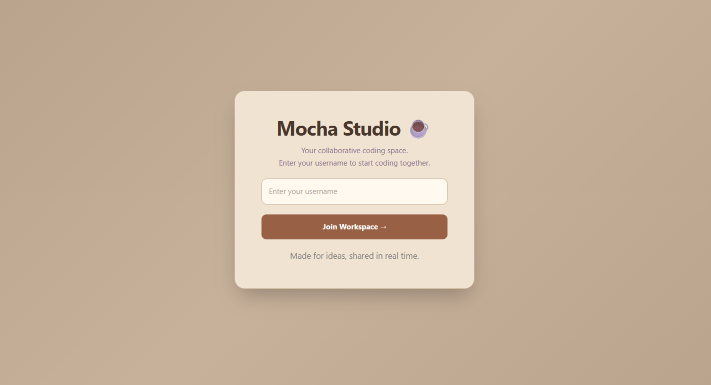
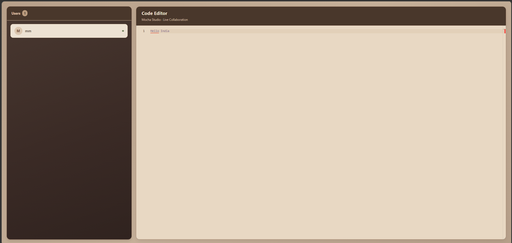

# CodeBuddy 💻

### Real-Time Collaborative Code Editor

CodeBuddy is a real-time collaborative code editor that allows multiple users to join a shared workspace and edit code together. Built with React, Monaco Editor, Yjs, and Socket.IO, it explores the foundations of collaborative development tools through synchronized editing and live user presence.

The project is currently **Dockerized and running locally**. Cloud deployment is planned for a future phase.

---

## 📸 Screenshots

### Welcome Screen


### Collaborative Editor



## ✨ Features

- **Real-Time Collaborative Editing:** Synchronize code changes between multiple connected users using Yjs.
- **Monaco Editor Integration:** A browser-based coding experience powered by the editor behind Visual Studio Code.
- **Live User Presence:** Display usernames of connected collaborators in the shared workspace.
- **Custom Editor Theme:** Mocha Studio, a warm cream-and-brown theme designed for a comfortable coding experience.
- **Username-Based Entry:** Join the workspace by entering a username.
- **Containerized Application:** Use Docker and a multi-stage build to build the frontend and package it with the backend.
- **Shared Workspace:** Connect clients to the same collaboration room for synchronized editing.

## 🛠️ Tech Stack

| Layer | Technologies |
|---|---|
| Frontend | React, Vite, Tailwind CSS |
| Code Editor | Monaco Editor |
| Real-Time Synchronization | Yjs, y-monaco |
| Communication | Socket.IO, y-socket.io |
| Backend | Node.js, Express.js |
| Containerization | Docker, multi-stage builds |

## 🏗️ Architecture

CodeBuddy uses a React frontend for the user interface and Monaco Editor for code editing. Yjs maintains the shared document state, while the Socket.IO-based provider synchronizes collaboration data between connected clients through the backend.

The application is packaged using a multi-stage Docker build: the frontend is built separately, and its production assets are copied into the backend image.

┌──────────────────────────────┐
│        React Frontend        │
│                              │
│  Monaco Editor + Mocha Theme │
│  User Presence Interface     │
└──────────────┬───────────────┘
               │
        Yjs + y-monaco
               │
        Socket.IO Provider
               │
┌──────────────▼───────────────┐
│       Node.js Backend        │
│       Express + Socket.IO    │
└──────────────┬───────────────┘
               │
       Docker Container

## 🚀 Getting Started

### Prerequisites

- Node.js and npm
- Docker Desktop
- Git

### 1. Clone the repository

```bash
git clone <https://github.com/ArpitaM27/CodeBuddy.git>
cd CodeBuddy
```

### 2. Run locally without Docker

Install and start the frontend and backend separately.

**Backend**

```bash
cd backend
npm install
node server.js
```

**Frontend**

In another terminal:

```bash
cd Frontend
npm install
npm run dev
```

### 3. Build with Docker

From the project root, where the Dockerfile is located:

```bash
docker build -t codebuddy .
```

### 4. Run the container

If the backend listens on port `3000` inside the container:

```bash
docker run --rm -p 3000:3000 codebuddy
```

Open `http://localhost:3000` in your browser.

If port `3000` is already in use on your computer, map a different host port:

```bash
docker run --rm -p 3001:3000 codebuddy
```


## 🐳 Dockerization

CodeBuddy uses a multi-stage Docker build to separate frontend compilation from backend runtime setup.

- Builds the React frontend using Vite.
- Installs frontend and backend dependencies separately.
- Copies the production frontend build into the backend image.
- Packages the application into a Docker image for consistent local execution.


## 📚 What This Project Explores

CodeBuddy is a practical exploration of:

- Building interactive applications with React
- Integrating browser-based developer tools
- Synchronizing shared application state with Yjs
- Managing real-time communication using Socket.IO
- Packaging frontend and backend components with Docker
- Preparing a full-stack application for cloud deployment

#

---

*Built to explore how collaborative developer tools work, one synchronized edit at a time.*